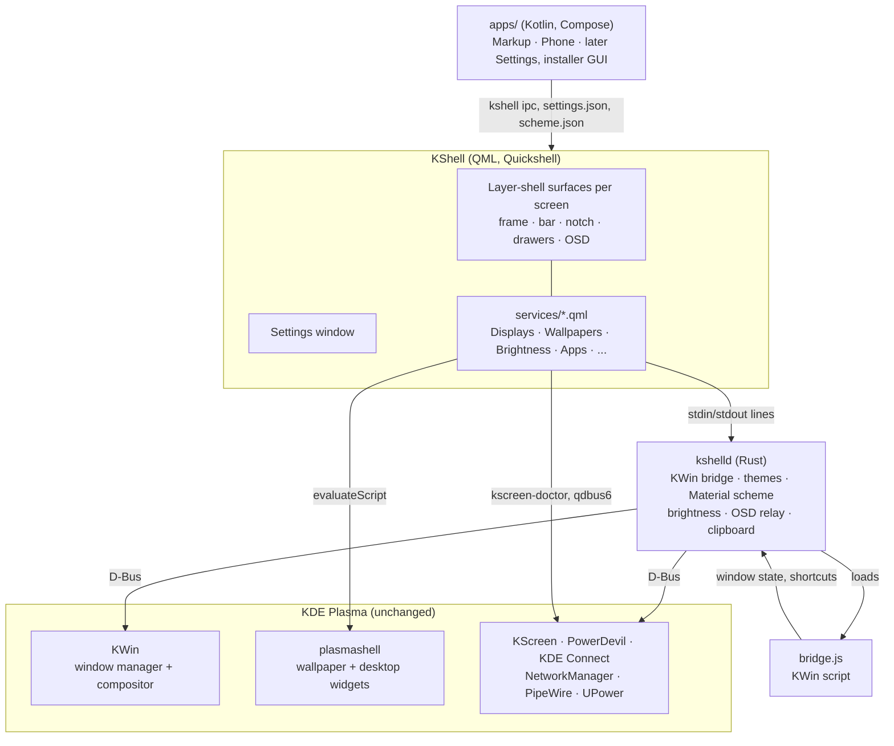

# Architecture

droid is layers on top of Plasma. Plasma and KWin do what they're good at;
KShell draws everything you look at; kshelld talks to the system for it.

## The pieces

| Piece | Language | Where | Does |
| --- | --- | --- | --- |
| KShell | QML | `home/.config/quickshell/kshell/` | Every surface: frame, bar, notch, drawers, OSD, notifications, settings |
| kshelld | Rust | `…/kshell/daemon/` | System access KShell can't do from QML: the KWin bridge, theme application, Material colours, brightness, the OSD relay, clipboard history |
| bridge.js | JavaScript | `…/kshell/bridge/` | A KWin script: window and desktop state, global shortcuts |
| Shaders | GLSL | `…/kshell/shaders/` | Wallpaper transitions, precompiled to `.qsb` |
| Installer | Python | `install.py`, `installer/` | Packages, links, fonts, enabling KShell |
| Apps | Kotlin | `apps/` | Normal app windows with Compose Material 3 |

## Why not one language

Quickshell is a QML runtime, so the shell is QML. KWin only runs JavaScript
and QML scripts. Layer-shell surfaces (bars, overlays) can't be Compose
windows, which is why Kotlin is for app windows. kshelld is Rust because it's
small, fast to start and light on memory, and the installer is Python because
a fresh Arch install already has it. See the [Roadmap](../roadmap.md) for
where Kotlin goes next.
